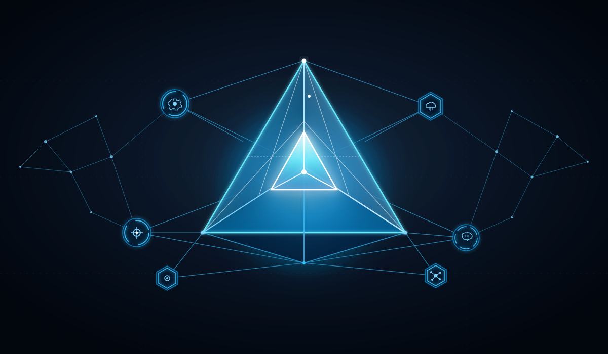

# 🔷 Manual de Identidad Visual & Sistema de Diseño — Vertex (Jarvis)

> **Documento de Referencia Técnica y Artística**  
> *Para ser implementado en el proyecto Jarvis al concluir las fases de Synaps Aerarium.*  
> **Archivo Fuente Oficial:** [`Vertex.png`](file:///c:/Users/crhis/OneDrive/Documentos/Cris/Proyectos/App%20Control%20Gastos/Vertex.png)

---

## 1. Concepto Semántico & Filosofía Visual

**Vertex** representa la cúspide de una inteligencia conectada y omnisciente. Visualmente combina:
- **El Tetraedro Central Luminoso:** Estructura piramidal tridimensional con vértice ascendente que simboliza jerarquía de datos, síntesis analítica y procesamiento de alto orden.
- **La Constelación Neural Orbital:** Red de conectores geométricos delgados que vinculan la inteligencia central con satélites periféricos funcionales.
- **Nodos Periféricos Especializados:**
  - ⚙️ **Nodo Motor / Configuración (Arriba Izquierda):** Engranaje en hexágono (ejecución de procesos y backend).
  - ☂️ **Nodo Resguardo / Seguridad (Arriba Derecha):** Escudo protector de datos y finanzas.
  - 🎯 **Nodo Precisión / Radar (Abajo Izquierda):** Detección de patrones y objetivos.
  - 💬 **Nodo Comunicación / Chat (Abajo Derecha):** Interfaz conversacional y asistente inteligente.
  - 🔗 **Nodo Integración / Conectividad (Abajo Centro):** Enlace con APIs externas, bases de datos y webhooks.

---

## 2. Paleta Cromática Oficial (Tokens de Color)

### Primarios: Profundidad Espacial & Núcleo
| Token | HEX | HSL / RGB | Uso |
|---|---|---|---|
| `--vertex-noir-base` | `#07090e` | `rgb(7, 9, 14)` | Fondo general del viewport / lienzo principal |
| `--vertex-slate-dark` | `#0e131f` | `rgb(14, 19, 31)` | Fondo de tarjetas, paneles y superficies elevadas |
| `--vertex-surface-card` | `rgba(18, 25, 41, 0.75)` | `rgba(18, 25, 41, 0.75)` | Paneles con efecto Glassmorphism |

### Acentos de Energía & Resplandor (Glow)
| Token | HEX | HSL / RGB | Uso |
|---|---|---|---|
| `--vertex-cyan-core` | `#38bdf8` | `rgb(56, 189, 248)` | Vértice central, líneas de red activas, bordes brillantes |
| `--vertex-cyan-neon` | `#00f0ff` | `rgb(0, 240, 255)` | Núcleo brillante, destellos y estados `:hover` |
| `--vertex-blue-electric` | `#0284c7` | `rgb(2, 132, 199)` | Conectores neurales secundarios, enlaces |
| `--vertex-blue-deep` | `#0369a1` | `rgb(3, 105, 161)` | Gradientes de fondo sutiles |
| `--vertex-white-hot` | `#ffffff` | `rgb(255, 255, 255)` | Centro de luz del tetraedro y tipografía destacada |

### Resplandores y Sombras Lumínicas (Atmospheric Glow)
```css
/* Sombras de Neón */
--glow-cyan-sm: 0 0 10px rgba(56, 189, 248, 0.4);
--glow-cyan-md: 0 0 22px rgba(56, 189, 248, 0.55);
--glow-cyan-lg: 0 0 45px rgba(0, 240, 255, 0.35);

/* Gradientes Oficiales */
--grad-vertex-tetrahedron: linear-gradient(180deg, #ffffff 0%, #38bdf8 35%, #0284c7 80%, #0c4a6e 100%);
--grad-vertex-halo: radial-gradient(circle, rgba(56, 189, 248, 0.25) 0%, rgba(7, 9, 14, 0.95) 70%);
```

---

## 3. Tipografía Recomendada para Jarvis

1. **Titulares & Logotipo:**
   - **`Cinzel`** (Romano / Clásico / Solemne) para títulos heráldicos o de autoridad ejecutiva.
   - **`Orbitron`** o **`Outfit`** (Geometric Sans / Futurista) para la interfaz de comando de Jarvis.
2. **Cuerpo de Texto y Mensajes de Chat:**
   - **`Inter`** o **`Outfit`** (Legibilidad moderna de alta resolución).
3. **Métricas, Código y Fechas:**
   - **`JetBrains Mono`** (Terminal, valores financieros y estados de sistema).

---

## 4. Componentes UI para Jarvis (Snippets Listos para Usar)

### A. Avatar de Chatbot en Conversación
```html
<div class="jarvis-chat-bubble">
  <div class="vertex-avatar-frame">
    
    <span class="vertex-pulse-ring"></span>
  </div>
  <div class="vertex-message-body">
    <div class="vertex-sender-tag">JARVIS // VERTEX AI</div>
    <div class="vertex-text">Sistemas nominales. Esperando instrucción.</div>
  </div>
</div>
```

```css
.vertex-avatar-frame {
  position: relative;
  width: 44px;
  height: 44px;
  border-radius: 50%;
  padding: 2px;
  background: var(--vertex-slate-dark);
  border: 1.5px solid var(--vertex-cyan-core);
  box-shadow: var(--glow-cyan-sm);
  display: flex;
  align-items: center;
  justify-content: center;
}

.vertex-avatar-img {
  width: 100%;
  height: 100%;
  object-fit: cover;
  border-radius: 50%;
}

.vertex-pulse-ring {
  position: absolute;
  inset: -4px;
  border-radius: 50%;
  border: 1px solid rgba(56, 189, 248, 0.3);
  animation: vertexAuraPulse 3s infinite ease-out;
  pointer-events: none;
}

@keyframes vertexAuraPulse {
  0% { transform: scale(0.95); opacity: 0.8; }
  50% { transform: scale(1.15); opacity: 0.2; }
  100% { transform: scale(0.95); opacity: 0.8; }
}
```

### B. Tarjeta Holográfica / Card con Borde Neón
```css
.vertex-card {
  background: var(--vertex-surface-card);
  backdrop-filter: blur(16px);
  border: 1px solid rgba(56, 189, 248, 0.2);
  border-radius: 16px;
  padding: 24px;
  box-shadow: 0 15px 35px -10px rgba(0, 0, 0, 0.7);
  transition: all 0.3s cubic-bezier(0.4, 0, 0.2, 1);
  position: relative;
  overflow: hidden;
}

.vertex-card::before {
  content: '';
  position: absolute;
  top: 0;
  left: 0;
  right: 0;
  height: 2px;
  background: linear-gradient(90deg, transparent, var(--vertex-cyan-neon), transparent);
}

.vertex-card:hover {
  border-color: rgba(56, 189, 248, 0.5);
  box-shadow: 0 20px 40px -10px rgba(0, 0, 0, 0.8), var(--glow-cyan-sm);
  transform: translateY(-2px);
}
```

---

## 5. Hoja de Ruta de Implementación en Jarvis

Al concluir las fases operativas de Aerarium:
1. **Copiar Activo:** Llevar [`Vertex.png`](file:///c:/Users/crhis/OneDrive/Documentos/Cris/Proyectos/App%20Control%20Gastos/Vertex.png) a la raíz o carpeta de estáticos del proyecto Jarvis.
2. **Telegram BotPic:** Configurar con `@BotFather` como avatar del bot.
3. **PWA Manifest:** Configurar `manifest.json` de Jarvis con `Vertex.png` como icono de pantalla de inicio.
4. **Plantilla de Estilos:** Adoptar los tokens `--vertex-*` definidos en la Sección 2.
